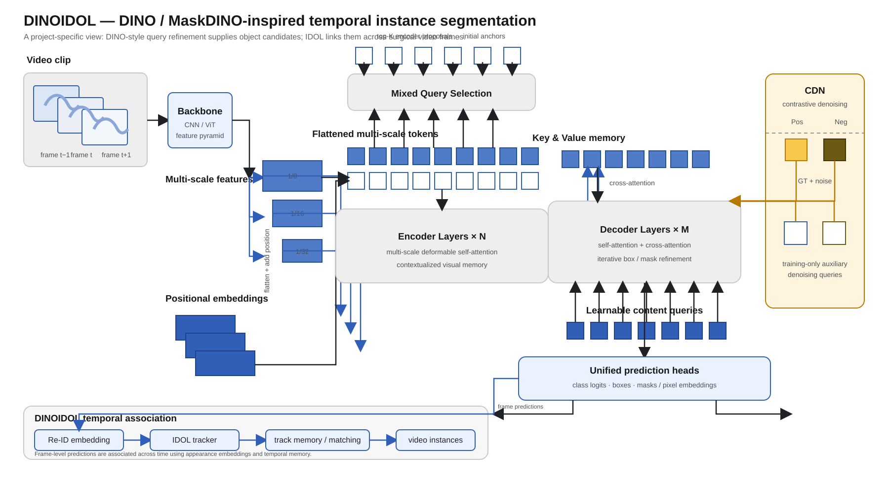
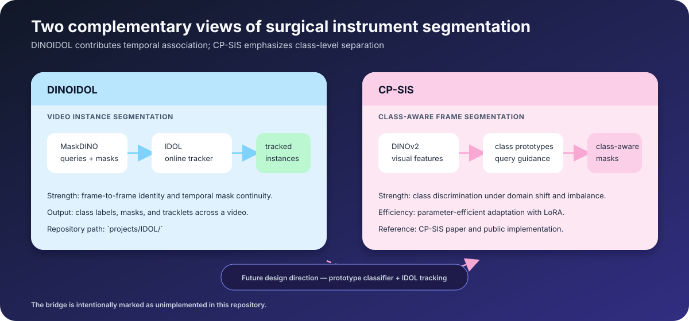

# DINOIDOL

**DINOIDOL** is a research implementation for online video instance segmentation of surgical instruments. It combines an IDOL-style temporal association pipeline with a DINO/MaskDINO query-based detector and mask head, targeting the EndoVis 2018 robotic-scene segmentation setup.

This repository is a Detectron2-based research fork. It contains the IDOL project code, the DINOIDOL EV18 configuration, custom multi-scale deformable-attention operators, and the training entry points used for the experiments.

> Research code. The repository does not ship the EndoVis data, pretrained weights, or the external MaskDINO source tree.

## What DINOIDOL does

For a sampled key/reference frame pair, DINOIDOL:

1. extracts multi-scale features with the MaskDINO backbone and pixel decoder;
2. predicts query-level classes, boxes, masks, and instance embeddings;
3. trains the key-frame detector with set matching and uses the paired reference frame for re-identification supervision;
4. associates detections online with IDOL's appearance-and-mask tracker; and
5. aggregates per-frame predictions into video-level instrument instances.

The main model is selected by:

```yaml
MODEL:
  META_ARCHITECTURE: "DINOIDOL"
```

The canonical EV18 experiment is [projects/IDOL/configs/EV18_DINOIDOL_r50.yaml](projects/IDOL/configs/EV18_DINOIDOL_r50.yaml). The older [EV18_r50.yaml](projects/IDOL/configs/EV18_r50.yaml) config is the non-DINO IDOL baseline.

The diagram below is an original project-specific sketch inspired by the [DINO/MaskDINO component split](https://github.com/IDEA-Research/MaskDINO#model-components): backbone, pixel decoder (multi-scale encoder), and Transformer decoder.

<p align="center">
  
</p>

## DINOIDOL and CP-SIS

This repository and [CP-SIS](https://github.com/Kunaldargan/CP_SIS) address related but different parts of surgical instrument understanding:

| Work | Main emphasis | Temporal behavior |
| --- | --- | --- |
| **DINOIDOL** | Query-based detection, mask prediction, and online video instance association | Explicit frame-to-frame tracking with IDOL embeddings |
| **CP-SIS** | Learnable class prototypes, query-guided classification, and efficient DINOv2 adaptation | Primarily frame-level surgical instrument segmentation |

CP-SIS is described in *CP-SIS: Learnable Class Prototypes for Efficient Surgical Instrument Segmentation*, ICVGIP 2025, [DOI: 10.1145/3774521.3774567](https://doi.org/10.1145/3774521.3774567). Its motivation is especially relevant to EV18: generic visual features can confuse visually similar instruments under domain shift and long-tailed class frequencies. DINOIDOL supplies a useful temporal foundation for that setting, while a prototype classifier is a possible future replacement for the current query classification layer. That combination is a design direction, not a component currently included in this checkout.

<p align="center">
  
</p>

For the earlier online video segmentation method that DINOIDOL extends, see [IDOL](projects/IDOL/IDOL.md) and [In Defense of Online Models for Video Instance Segmentation](https://arxiv.org/abs/2207.07163).

## Repository layout

```text
.
├── projects/IDOL/
│   ├── configs/EV18_DINOIDOL_r50.yaml   # DINOIDOL EV18 experiment
│   ├── idol/dinoidol.py                  # DINOIDOL meta-architecture
│   ├── idol/idol.py                      # IDOL baseline meta-architecture
│   ├── idol/data/                        # YTVIS/EV18 loading and evaluation
│   ├── idol/models/                      # matching, masks, embeddings, tracking
│   └── idol/models/ops/                  # CUDA multi-scale deformable attention
├── projects/MaskDINO                     # external MaskDINO dependency location
├── train_net_video_EV18_DINOIDOL.py     # DINOIDOL training/evaluation script
├── train_net_video_EV18.py               # IDOL baseline training/evaluation script
└── IDOL_EV18.sh                           # local single-GPU launcher example
```

## Installation

DINOIDOL inherits Detectron2's native/CUDA build requirements. Use a matching PyTorch, torchvision, CUDA toolkit, and compiler toolchain.

```bash
git clone <repository-url> DINOIDOL
cd DINOIDOL

python3 -m venv .venv
source .venv/bin/activate
python -m pip install --upgrade pip
python -m pip install -e .
```

The DINOIDOL model imports MaskDINO through `detectron2.projects.maskdino`. The `projects/MaskDINO` entry in this fork is an external project reference; make sure a compatible MaskDINO checkout is present there before importing DINOIDOL. The upstream implementation is available at [IDEA-Research/MaskDINO](https://github.com/IDEA-Research/MaskDINO).

Build the custom operator before training:

```bash
cd projects/IDOL/idol/models/ops
bash make.sh
cd ../../../../..
```

For general Detectron2 installation and CUDA troubleshooting, see [INSTALL.md](INSTALL.md).

## Dataset layout

The EV18 training script registers the following paths relative to the repository root:

```text
datasets/EV18/
├── train.json
├── valid.json
├── train/JPEGImages/
└── valid/JPEGImages/
```

The JSON files must follow the YTVIS-style video annotation format expected by `register_ytvis_instances`. Keep dataset files outside version control; the repository's `.gitignore` already excludes `datasets/*` contents.

## Train

Set the pretrained checkpoint path before running. The checked-in config contains a machine-specific historical path, so override it on the command line or edit the config locally.

```bash
python3 train_net_video_EV18_DINOIDOL.py \
  --config-file projects/IDOL/configs/EV18_DINOIDOL_r50.yaml \
  --num-gpus 1 \
  MODEL.WEIGHTS /absolute/path/to/cocopretrain_R50.pth
```

The default output directory is `./output_EV18`. To resume from the latest checkpoint in that directory, add `--resume`.

The included launcher is a local single-GPU example and can be adapted to your environment:

```bash
bash IDOL_EV18.sh
```

The script currently assumes the dataset is at `./datasets/EV18` and the config's default local conventions. For a different layout, update the paths in the launcher or training script before use.

## Evaluate

```bash
python3 train_net_video_EV18_DINOIDOL.py \
  --eval-only \
  --config-file projects/IDOL/configs/EV18_DINOIDOL_r50.yaml \
  --num-gpus 1 \
  MODEL.WEIGHTS /absolute/path/to/checkpoint.pth
```

Evaluation writes predictions and metrics under the configured output directory. The YTVIS evaluator emits video-level JSON results; use the relevant EndoVis challenge protocol for final benchmark reporting.

## Configuration notes

The EV18 DINOIDOL config currently uses:

- ResNet-50 features with MaskDINO's transformer decoder;
- seven instrument classes;
- two sampled frames per training clip;
- AdamW with a reduced backbone learning-rate multiplier;
- mask, box, class, and re-identification objectives; and
- online tracking with short-term memory during inference.

Important paths and settings live in [EV18_DINOIDOL_r50.yaml](projects/IDOL/configs/EV18_DINOIDOL_r50.yaml), while shared defaults are registered in [idol/config.py](projects/IDOL/idol/config.py).

## Known limitations

- This is an experiment-oriented fork rather than a packaged application.
- Dataset paths and the pretrained checkpoint are not portable by default.
- The custom attention operator requires a CUDA build; CPU-only environments are not the supported training target.
- MaskDINO is an external dependency and must match the API expected by this fork.
- No pretrained DINOIDOL EV18 checkpoint is included in the repository.

## References

- Zhang et al., [DINO: DETR with Improved DeNoising Anchor Boxes for End-to-End Object Detection](https://arxiv.org/abs/2203.03605), ICLR 2023.
- Wu et al., [In Defense of Online Models for Video Instance Segmentation](https://arxiv.org/abs/2207.07163), ECCV 2022.
- Li et al., [Mask DINO: Towards a Unified Transformer-Based Framework for Object Detection and Segmentation](https://openaccess.thecvf.com/content/CVPR2023/papers/Li_Mask_DINO_Towards_a_Unified_Transformer-Based_Framework_for_Object_Detection_CVPR_2023_paper.pdf), CVPR 2023.
- Dargan, Jangamreddy, and Arora, [CP-SIS: Learnable Class Prototypes for Efficient Surgical Instrument Segmentation](https://doi.org/10.1145/3774521.3774567), ICVGIP 2025.
- [Endoscopic Vision Challenge datasets and publications](https://opencas.dkfz.de/endovis/datasetspublications/).

## Acknowledgements

This project builds on [Detectron2](https://github.com/facebookresearch/detectron2), [IDOL](https://github.com/wjf5203/VNext), [MaskDINO](https://github.com/IDEA-Research/MaskDINO), [Deformable DETR](https://github.com/fundamentalvision/Deformable-DETR), and [VisTR](https://github.com/Epiphqny/VisTR). Please follow the original licenses and citation requirements for each upstream project.
